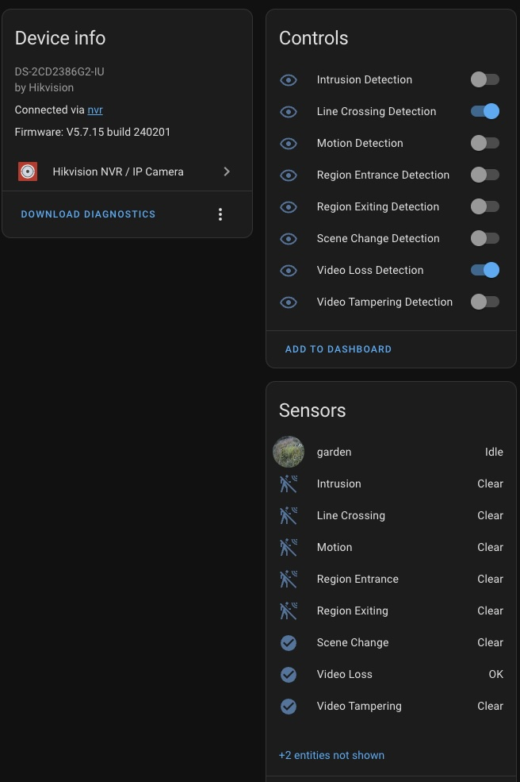
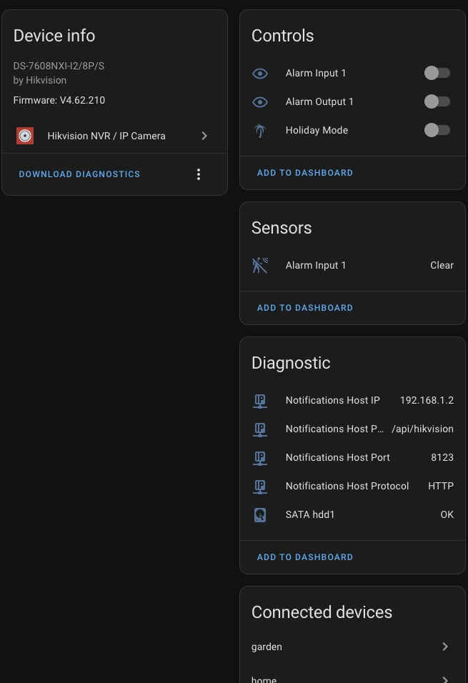
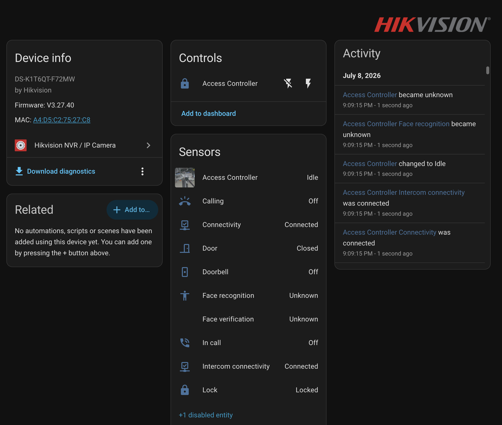
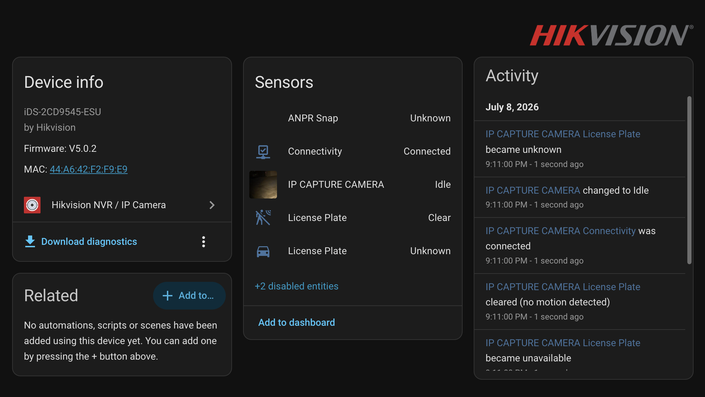

# Hikvision Next

 [](https://github.com/hacs/integration)

The Home Assistant integration for Hikvision NVRs and IP cameras. Receives and switches detection of alarm events. Provides video streams.

## Features

- Camera entities for main and sub streams
- Optional SDK H.264 WebRTC video with one-way audio, without an external media server
- Real-time Acusense events notifications through binary sensors and HA events (hikvision_next_event)
- Switches for Acusense events detection
- Switches for NVR Outputs and PIR sensor
- Holiday mode switch (allows to switch continuous recording with appropriate NVR setup)
- Image entities for the latest snapshots
- Tracking HDD and NAS status
- Tracking Notifications Host settings for diagnostic purposes
- Remote reboot device
- Basic and digest authentication support

### Supported events

- Motion
- Video Tampering
- Video Loss
- Scene Change
- Intrusion (Field Detection)
- Line Crossing
- Region Entrance
- Region Exiting
- NVR Input Triggers
- PIR
- Face Recognize Result
- Door Lock/Unlock
- Lock/Unlock

**NOTE**
Events must be set to alert the surveillance center in Linkage Action for Home Assistant to be notified. Otherwise related binary sensors and switches will appear as disabled entities.

### Blueprints

#### Take Multiple Snapshots On Detection Event

Creates automation that allows to take snapshots from selected cameras when an event sensor is triggered.

[](https://my.home-assistant.io/redirect/blueprint_import/?blueprint_url=https://github.com/maciej-or/hikvision_next/blob/main/blueprints/take_pictures_on_motion_detection.yaml)

#### Display Sensor State On Hikvision Video

Creates an automation that allows to display text overlay on a selected video stream with the state of a selected sensor. Refreshes every 15 minutes.

[](https://my.home-assistant.io/redirect/blueprint_import/?blueprint_url=https://github.com/maciej-or/hikvision_next/blob/main/blueprints/display_sensor_state_on_hikvision_video.yaml)

## Preview

### IP Camera device view


### NVR device view


### ACS device view


### ANPR device view


The scope supported features depends on device model, setup and firmware version.

## Installation

[](https://my.home-assistant.io/redirect/hacs_repository/?owner=maciej-or&repository=hikvision_next&category=integration)

### With HACS

1. This integration you will find in the default HACS store. Search for `Hikvision NVR / IP Camera` on `HACS / Integrations` page and press `Download` button
2. on `Settings / Devices & Services` page press `+ Add Integration`
3. Search for `Hikvision NVR / IP Camera` and add your Hikvision device using config dialog, repeat the last 2 steps for more devices

### Manual

1. copy `custom_components/hikvision_next` folder into `conifg/custom_components`
2. restart Home Assistant
3. on `Settings / Devices & Services` page press `+ Add Integration`
4. search for `Hikvision NVR / IP Camera` and add your Hikvision device using config dialog, repeat the last 2 steps for more devices

## SDK low-latency video

In the integration's **Reconfigure** dialog, select **SDK** as the connection type
and enable **SDK WebRTC low-latency video**. The option is off by default. Use
Home Assistant 2025.10 or later on Linux amd64/aarch64; the integration installs
`aiortc==1.14.0` and uses PyAV. No SRS, go2rtc, FFmpeg executable, WHEP endpoint,
or custom dashboard card is required.

H.264 main/sub/additional-stream camera entities use HA's native WebRTC player. H.265
and other streams keep their existing RTSP playback. Entity IDs, snapshots, and
the RTSP source used by recording remain unchanged. Enable sub-stream entities
in the entity settings if needed. Choose H.264 without B-frames and a short GOP
on the camera for predictable latency and first-frame startup. The camera's
actual H.264 profile must be offered by the browser. A sufficiently high offered
level is preferred. When the offer allows level asymmetry, the integration can
also attempt unchanged packet passthrough above the advertised default level;
this does not establish that the browser can decode that resolution or bitrate.
The actual source profile/level remains in the SDP answer and SPS. No stream
is silently relabeled, transcoded, or switched to a different quality. If the
receiver cannot decode a high-resolution main stream, select a compatible
H.264 sub-stream or lower the camera's resolution/level. Incompatible profiles
and non-asymmetric offers with insufficient levels produce explicit errors.
The SDK can request keyframes for main/sub streams; additional streams wait
for their next periodic keyframe.

Video is forwarded as compressed packets. G.711 A-law/µ-law and AAC (ADTS) audio
is decoded and sent as Opus when the browser requests audio; no microphone or
two-way talk is enabled. Unsupported/missing audio formats do not prevent video
playback. Camera audio settings are read from the stream's ISAPI configuration,
not the separate talk-channel settings.

Viewing starts the SDK preview on demand. Multiple viewers share one upstream
preview; after the final session closes it stays warm for 30 seconds, then releases
the SDK handle. A bounded complete GOP cache (up to 250 ms old) seeds new viewers.
Video RTP yields between 16-packet bursts and keeps up to 2048 packets / 8 MiB
for NACK retransmission, to accommodate large IDRs without blocking audio.
Input silence/overflow rebuilds the preview, and bounded viewer queues discard
video older than 300 ms until the next IDR.
HA shutdown and integration unload close sessions before SDK logout. WebRTC
failure does not automatically switch the HA player to HLS: disable the option
to return to the previous playback method.

HA's configured ICE servers are used for the peer connection. Remote access
requires reachable ICE candidates or TURN; an HTTP reverse proxy alone does
not carry WebRTC media. This mode targets sub-second LAN playback, but actual
camera-to-screen latency must be measured on the installed camera and browser.

The packet passthrough adapter is tested against aiortc 1.14.0. It translates
H.264 profile parameters only inside aiortc's Baseline-oriented negotiation and
restores the verified camera/browser parameters in the outgoing answer. RTCP
keyframe requests are forwarded to the SDK. Revalidate these adapters before
upgrading aiortc.

Some Main-profile encoders emit SPS `4d60xx` (including an extra constraint flag),
which aiortc's profile lookup does not recognize. The adapter advertises the
enclosing Main capability `4d40xx` in SDP, retaining the original level and
unchanged SPS/PPS/video packets. It still requires a Main-capable receiver and
never treats Main video as Baseline.

Enable debug logging for `custom_components.hikvision_next.webrtc` to inspect
cold/warm preview reuse, SDP/connection timings, cached frames, queue drops,
pacing yields and NACK retransmission/miss counts. Timings in these logs stop
at the sender; browser rendering latency still needs to be measured separately.

## Bundled Hikvision Camera card

For direct device access, restart HA and refresh the browser, then open
**Settings → Devices & services → Devices → the Hikvision device → Visit device**
(the link label depends on the HA language). Camera devices open their channel
directly; an NVR opens a channel selector. The integration automatically provides
this control page at `/hikvision-next-control/0`; no manual dashboard configuration
is needed. Only the selected channel is played, using the same bundled card.
Missing/disabled channels show a message instead of silently opening another
camera. A device-details link returns to the selected camera when its registry
information is available.

This page is an integration-owned view hosted by HA's card runtime. It is kept
in memory, hidden from the sidebar, and does not modify your existing dashboards.
Device links scope it to the configuration entry and channel; the usual HA
authentication and entity/service permissions apply.

The integration includes its own **Hikvision Camera** dashboard card. Restart
Home Assistant after installing/updating the integration, then reload the browser
page. Open **Edit dashboard → Add card → Hikvision Camera** and choose a camera.
The card module is registered automatically when HA's frontend is enabled;
there is no separate HACS frontend install, CDN or build step.

```yaml
type: custom:hikvision-camera-card
entity: camera.your_main_stream
name: Front door
muted: true
show_ptz: true
show_intercom: true
ptz_speed: 40
# Optional: otherwise discover enabled streams of the same channel automatically.
# sub_stream: camera.your_sub_stream
```

The visual editor supports the same options. Other stream entities must first be
enabled in the device's entity settings to appear in the stream picker; the card
does not change entity settings or camera encoding. Video uses HA's native
camera player: opted-in SDK H.264 entities retain SDK WebRTC, while other camera
entities retain their normal playback method. Switching streams releases the
previous player. Ordinary HA state updates do not recreate an active player.

The toolbar provides play/reconnect, sound, volume and fullscreen. Playback starts
muted by default to allow browser autoplay. On HA versions which omit muted audio
tracks, the first unmute reconnects the player to attach audio. If a browser
blocks audible autoplay, press play. Mobile browsers may use system volume or
their native fullscreen controls instead.

PTZ controls appear only for PTZ-capable channels. Hold a direction or zoom
button, then release to stop; keyboard Space/Enter also work. Movement stops on
pointer cancellation, focus loss, stream changes and card removal. One continuous
press is limited to 10 seconds; release and press again to continue. The stop
command is queued after an in-flight move so a quick tap cannot reorder them.
In SDK mode, NVR IP channels use native SDK PTZ when the login provides a digital
channel mapping (logical channel 34 → SDK channel 34 when the range starts at 1,
or SDK channel 66 when it starts at 33). The remote camera's input port is not an NVR channel number.
Native API failures fall back to the ISAPI proxy, and stops follow the route
that actually started movement. SDK `PUT` status-buffer responses are checked
for device rejection rather than treating transport success as action success.
SDK video intercom devices also show answer/reject/hang-up buttons using the
existing integration actions. These are call controls; the card does not add
microphone audio or two-way voice streaming. Service errors appear in the card.

For frontend development only, run `npm ci && npm test` (Node.js 20+).
Frontend tests use a DOM environment with a stub native camera player; real
browser playback and device controls still require testing on your installation.

## Hikvision device setup checklist

- Network settings
  - enabled ISAPI access
- User Management - create user with permissions:
  - Remote: Parameters Settings
  - Remote: Log Search / Interrogate Working Status
  - Remote: Live View
  - Remote: Notify Surveillance Center / Trigger Alarm Output
- Events
  - Notify Surveillance Center
  - Regions if needed
  - Arming Schedule
- Storage Schedule Settings - set continuous recording in Holiday mode for desired cameras
- Notifications Host - IP address of Home Assistant instance for event notifications. Can be set manually or by this integration if checked `Set Notifications Host` checkbox in the configuration dialog. It will be reverted to `http://0.0.0.0:80/` on integration unload.

## Reporting issues

There are a lot of Hikvision devices with different firmwares in the world. In most cases logs are crucial to solve your problem, so please attach them to the report.
Keep in mind that logs include MAC addresses, serial numbers and local IP addresses of your devices. Consider using [pastebin.com](https://pastebin.com) or similar services for sharing logs.

You can also download a `diagnostic output` to provide essential information about your device. It is available on device info page. This redacts all sensitive data and can be provided in the github issue.

Setup log level to `debug` in configuration.yaml

```yaml
logger:
  logs:
    custom_components.hikvision_next: debug
```

Restart Home Assistant

Download logs from `Settings / System / Logs`

## Tested models

### NVR

- Annke N46PCK
- DS-7108NI-Q1/8P
- DS-7608NI-I2
- DS-7608NI-I2/8P
- DS-7608NXI-I2/8P/S
- DS-7608NXI-K1/8P
- DS-7616NI-E2/16P
- DS-7616NI-I2/16P
- DS-7616NI-Q2
- DS-7616NI-Q2/16P
- DS-7616NXI-I2/16P/S
- DS-7716NI-I4/16P
- DS-7732NI-M4
- ERI-K104-P4

### DVR

- iDS-7204HUHI-M1/FA/A
- iDS-7204HUHI-M1/P
- iDS-7208HQHI-M1(A)/S(C)

### IP Camera

- Annke C800 (I91BM)
- DS-2CD2047G2-LU/SL
- DS-2CD2047G2H-LIU
- DS-2CD2087G2-LU
- DS-2CD2146G2-ISU
- DS-2CD2155FWD-I
- DS-2CD2346G2-IU
- DS-2CD2386G2-IU
- DS-2CD2387G2-LU
- DS-2CD2387G2H-LISU/SL
- DS-2CD2425FWD-IW
- DS-2CD2443G0-IW
- DS-2CD2532F-IWS
- DS-2CD2546G2-IS
- DS-2CD2747G2-LZS
- DS-2CD2785G1-IZS
- DS-2CD2H46G2-IZS (C)
- DS-2CD2T46G2-ISU/SL
- DS-2CD2T87G2-L
- DS-2CD2T87G2P-LSU/SL
- DS-2DE4425IW-DE (PTZ)
- DS-2SE4C425MWG-E/26

### Access Control

- DS-K1T341M
- DS-K1T680M
- DS-K1T6QT-F72MW
